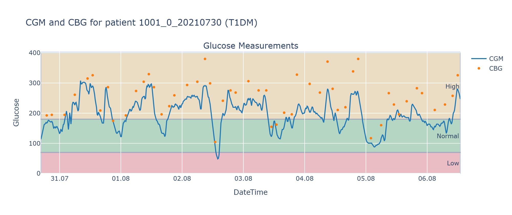
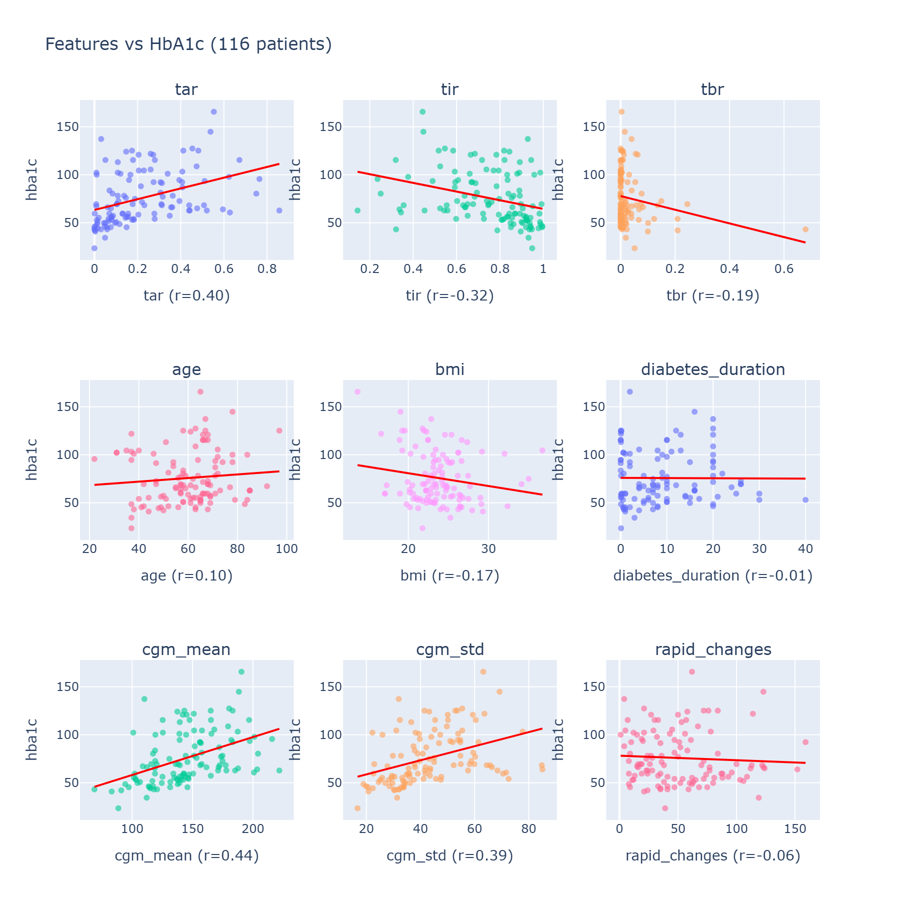
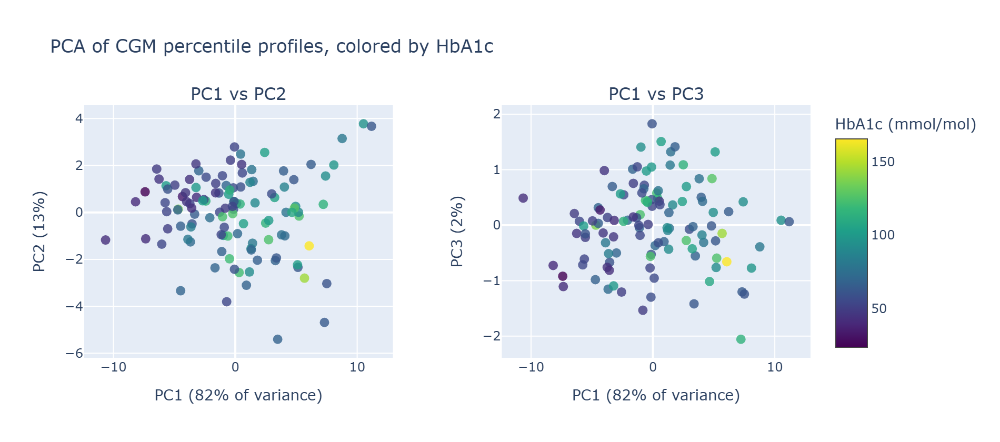
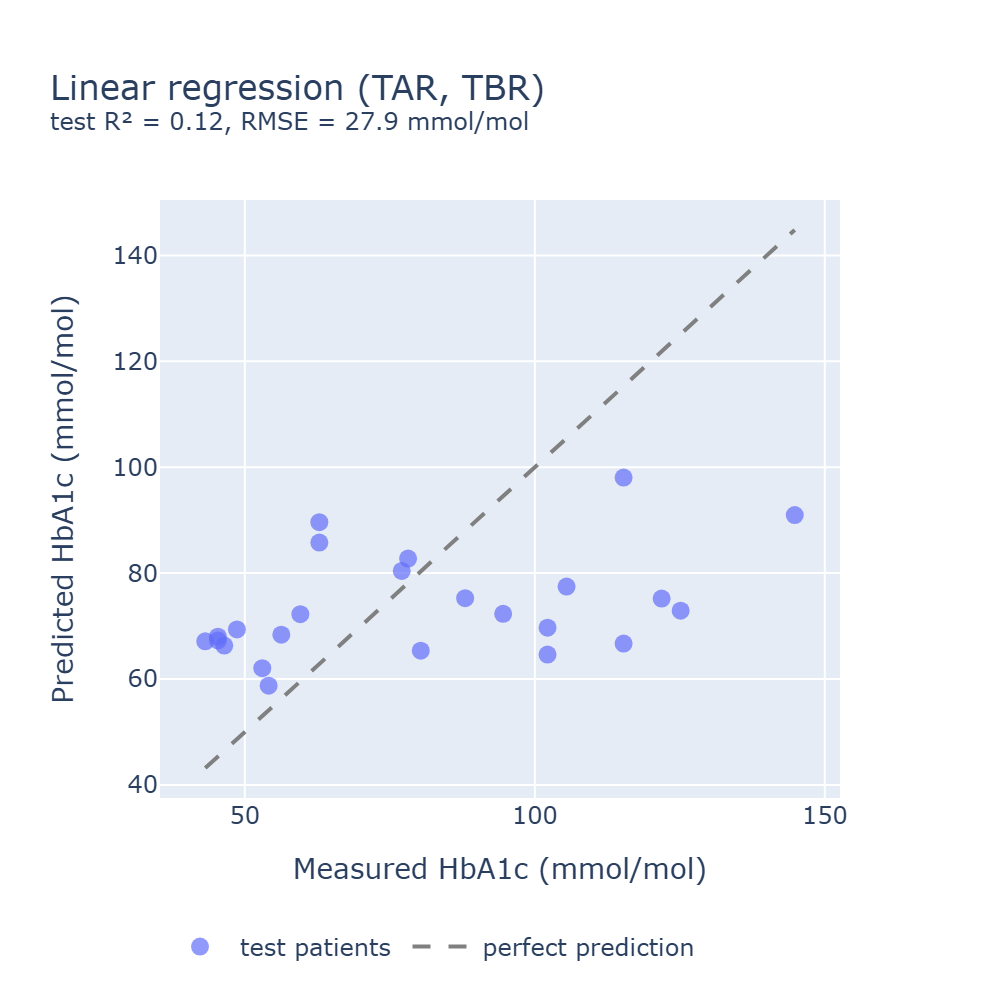
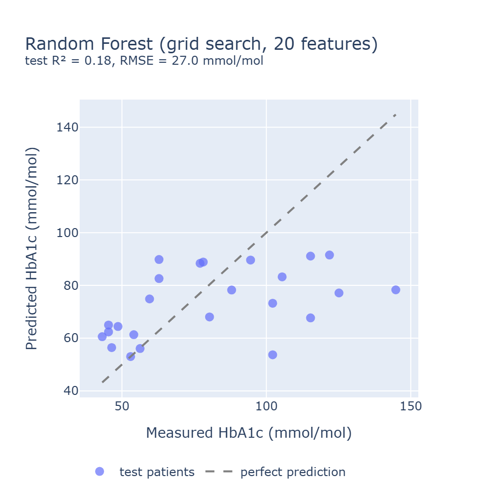
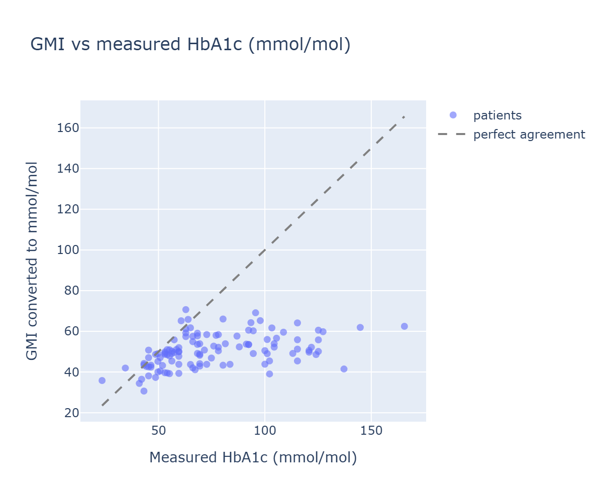

# Predicting HbA1c from CGM and Clinical Features

A small, hands-on machine learning project on diabetes data. The goal was to learn how to work with glucose time series (continuous glucose monitoring, CGM) and clinical records, and to test how well the available features can predict HbA1c, the standard long-term blood glucose marker.

**Main finding:** the CGM data I have, about 1 to 2 weeks per patient, probably carries too little information about HbA1c, or the HbA1c values were measured at a different time from the CGM. My models reach a mean held-out R² of about 0.24 over five random splits. A single calibrated CGM summary, the clinical Glucose Management Indicator (GMI) recalibrated on my training data, reaches the same level. Raw GMI, the published formula, is biased by about 25 mmol/mol for this cohort. The results are reported honestly below, including the hypotheses I could not test.

---

## Dataset

**Shanghai T1DM and T2DM dataset** (CGM time series with clinical summaries)

- **125 patients**: 16 with type 1 diabetes (T1DM), 109 with type 2 diabetes (T2DM)
- **CGM readings**: glucose in mg/dL, typically every 15 minutes, covering roughly 1 to 2 weeks per patient. Some patients have short gaps or irregular intervals.
- **Other time series**: sparse capillary glucose (CBG), insulin doses and medications, and dietary intake.
- **Summary record per patient**: HbA1c, age, gender, height, weight, BMI, smoking and alcohol history, diabetes duration, and laboratory values (lipids, creatinine, uric acid, and others).

Patients with a missing HbA1c (recorded as `/`) are excluded from modeling, which leaves **116 patients**.



*CGM (line) and finger-stick CBG (dots) for one T1DM patient over about a week. The shaded bands mark the low, normal and high glucose ranges. The CBG readings are sparse, and the CGM covers only a short window.*

> Citation: `Zhu, Jinhao (2022). Diabetes Datasets-ShanghaiT1DM and ShanghaiT2DM. figshare. Dataset. https://doi.org/10.6084/m9.figshare.20444397.v3`

> Dataset source: `https://figshare.com/articles/dataset/Diabetes_Datasets-ShanghaiT1DM_and_ShanghaiT2DM/20444397?file=38259264`

## Approach

### 1. Exploratory data analysis (`notebooks/00_eda.ipynb`)
- Loaded and merged the T1DM and T2DM files. Column names differ slightly between them and had to be standardized.
- Checked data quality: missing dates, irregular CGM intervals, non-numeric placeholders in numeric columns, and very different recording lengths per patient.
- Computed the monitoring duration per patient and visualized it by diabetes type.
- Calculated Time in Range (TIR), Time Above Range (TAR) and Time Below Range (TBR) per patient, using full 24-hour days only so the percentages are comparable.
- Plotted each candidate feature against HbA1c. Most features show a flat or noisy cloud, which is the first sign that they are weak predictors.



*Nine candidate features against measured HbA1c for all 116 patients, with a linear fit and Pearson r in each axis label. The strongest single relationships are TAR (r = 0.40) and mean CGM glucose (r = 0.44). TBR and TIR are weaker (r = -0.19 and -0.32), and age, BMI and diabetes duration show no useful trend.*

### 2. Feature engineering (`src/load_model_data.py`)
- **Glucose metrics**: TIR, TAR, TBR; CGM mean, standard deviation, coefficient of variation, quartiles, and range.
- **Variability and events**: counts of hypoglycemic (<70 mg/dL) and hyperglycemic (>180 mg/dL) readings, rapid glucose changes, and mean glucose excursion.
- **Clinical features**: age, gender (encoded 0/1), BMI, height, weight, smoking history, alcohol use (binary), diabetes type (binary), and diabetes duration.
- **CGM distribution**: every 5th percentile of each patient's CGM readings (21 values), which works for series of any length.
- **PCA components**: `pc1` to `pc3` are added in `src/prepare_splits.py`, with PCA fitted on the training split only.

### Visualization (`src/vis_utils.py`)
- Plotly functions shared by the notebooks: patient time series with glucose zones, monitoring-duration violin plots, correlation heatmap, and feature-vs-HbA1c scatter plots with trend lines and Pearson r.
- Each function returns a figure rather than showing it, so notebooks can display it or save it.
- Each PNG figure in this README is saved by the notebook that produces it, into `figures/`.

### 3. Dimensionality reduction (`notebooks/02_dim_reduction.ipynb`)
- Visualized per-patient CGM percentile profiles in 3D with PCA, UMAP and t-SNE, colored by HbA1c. A single script switches between the three methods.
- **All three used default settings** (UMAP `n_neighbors=15`, `min_dist=0.1`; t-SNE `perplexity=30`). None were tuned.
- PC1 carries 82% of the variance in the profiles. Its colour gradient against HbA1c is weak, so PCA summarizes the profiles rather than separating HbA1c cleanly. That is why the PCA components were tested as model features and judged on the test sets.



*Each point is one patient's CGM profile (21 percentiles, standardized) projected onto the first three principal components. Colour is measured HbA1c. The gradient is weak in both views.*

### 4. Evaluation protocol
- **Split**: 80/20 train/test. The saved split has 92 training and 24 test patients.
- **Tuning**: 5-fold cross-validation on the training set only. The test set is scored once per experiment.
- **Stability check**: the full pipeline is repeated over 5 random seeds, and results are reported as mean ± standard deviation instead of a single lucky split. The test sets overlap across seeds, so the standard deviation understates the real uncertainty.
- **Metric**: R² from `sklearn.metrics.r2_score` everywhere, so the notebooks are directly comparable.
- **Baselines**: a mean-only predictor (the floor for R² = 0), and GMI (the clinical standard), in raw and recalibrated form.

### 5. Modeling

**Linear regression** (`notebooks/01_linear_model.ipynb`): four experiments on the saved split.
- TAR and TBR: test R² 0.12
- Polynomial terms of TAR and TBR: test R² 0.11
- Adding age, gender and diabetes type: test R² 0.07
- 20 features (CGM summary, variability and clinical): test R² 0.10, with a validation R² of -0.45

**Random Forest** (`notebooks/01_random_forest.ipynb`): default and grid-searched forests on 5 and 20 features.
- Default forest: test R² 0.17 (5 features) and 0.18 (20 features)
- Grid search: test R² 0.11 (5 features) and 0.18 (20 features). The best CV score on 20 features rose from 0.16 to 0.20, but the test score did not improve.

**PCA features over five seeds** (`notebooks/03_models_w_pca_features.ipynb`): linear regression and a tuned Random Forest on `pc1` to `pc3`, compared with a mean-only predictor.

The best linear model (TAR and TBR) and the best forest (grid-searched, 20 features) are shown below on the saved test split. Points on the dashed line are perfect predictions.

<p align="center">
  
  
</p>

*Left: linear regression on TAR and TBR. Right: Random Forest, grid search on 20 features. Both models compress their predictions into a narrow band around the mean. Patients with very high measured HbA1c are predicted far too low, which is why the test R² stays near 0.1 to 0.2.*

### 6. GMI baseline (`notebooks/04_gmi_baseline.ipynb`)
- The Glucose Management Indicator estimates HbA1c from mean CGM glucose: GMI (%) = 3.31 + 0.02392 × mean glucose (mg/dL). Every CGM product shows it.
- Converted to mmol/mol with the IFCC formula (mmol/mol = 10.929 × (% − 2.15)) so it can be compared with the target, and checked against reference values.
- **Raw GMI** is strongly biased low for this cohort: about -25 mmol/mol on all patients, and a test R² of -0.67 over five seeds.
- **GMI recalibrated** on the training data (a single straight line) has a mean R² of 0.23 ± 0.13 over five seeds. That matches the linear model on PCA features and beats the Random Forest.



*Raw GMI against measured HbA1c for all 116 patients, after conversion to mmol/mol. Most points lie below the dashed line: the published formula underestimates HbA1c for this cohort on average.*

## Results and Conclusions

Five random seeds, the same test sets for every row. R² uses `r2_score`.

| Model | Mean R² | Std R² | Mean RMSE | Mean MAE |
|---|---|---|---|---|
| Mean-only predictor | -0.072 | 0.075 | 30.65 | 24.91 |
| Linear regression on PCA features | 0.235 | 0.131 | 25.90 | 19.86 |
| Random Forest, tuned | 0.134 | 0.136 | 27.55 | 21.30 |
| GMI, raw | -0.668 | 0.279 | 38.26 | 28.76 |
| GMI, recalibrated on train | 0.228 | 0.125 | 26.04 | 19.99 |

- **The available features are weak predictors of HbA1c.** The best models explain about a quarter of the variance on average, and the errors remain large in clinical terms (RMSE about 26 mmol/mol).
- **Published GMI does not transfer to this cohort.** It underestimates HbA1c by about 28 mmol/mol on average, and it is far worse than the mean-only predictor.
- **Once recalibrated, one CGM feature matches the best models.** The extra PCA components and the Random Forest add nothing measurable on this data.
- **Single correlations are modest.** TAR correlates with HbA1c at about r = 0.40 and TBR at about r = -0.19. Mean CGM glucose correlates at about r = 0.44, which is the same information that GMI uses.
- **Among the linear models, the simplest one is as good as any other.** Adding polynomial terms or demographics lowered validation R² and did not improve the test set.
- **Random Forest results are sensitive to the metric and the split.** Using the squared correlation instead of `r2_score` had inflated its test R² to 0.24 to 0.26. Grid search on 5 features raised the CV score but lowered the test score.

### The main result: the CGM window or the HbA1c timing

Every approach I tried reaches roughly the same ceiling. That includes a clinical formula designed for CGM data, which does as well as the best models once calibrated. This suggests the limit is in the information the data contains, not in the choice of model.

The most likely explanation is the one below. It is a hypothesis, and the current data cannot confirm it.
- **Timing mismatch.** HbA1c reflects average glucose over roughly the previous 2 to 3 months, while the CGM recordings cover only about 1 to 2 weeks. A short window cannot capture the full picture. HbA1c was also not necessarily measured close to the CGM recording.
- **GMI's population.** GMI was derived from other populations. Its bias here may come from the cohort, the short window, or both; this data cannot separate them.

Testing the hypothesis needs longer CGM windows, or HbA1c measured within days of the CGM recording. Until then, the honest conclusion is that the data does not support a more accurate prediction than a calibrated mean glucose.

**Other limitations:**
- **Small sample.** 116 usable patients, with only 16 T1DM, leaves little statistical power, and test-set estimates are noisy.
- **Limited clinical context.** Medication changes, adherence and other factors that drive HbA1c are only partly captured.

### Why I did not use deep learning on the CGM time series

The original plan included recurrent (RNN/LSTM) and transformer models trained directly on the CGM sequences. After exploring the data, I dropped this plan: with 116 patients, each contributing one series of varying length, there are far too few independent samples. A deep model would mostly memorize the training patients. Feature-based models were a better fit for this dataset size.

## Project Structure

```text
explore_diabetes_data/
├── data/
│   ├── raw/data/                 # Original T1DM/T2DM files as received
│   └── processed/
│       ├── data/                 # Files read by the data loaders
│       └── splits/               # Train/test splits written by prepare_splits.py
├── figures/                      # PNG figures used in this README
├── notebooks/                    # Analysis in order of the project story
│   ├── 00_eda.ipynb              # Data exploration and quality checks
│   ├── 01_linear_model.ipynb     # Linear regression experiments
│   ├── 01_random_forest.ipynb    # Random Forest, default and grid search
│   ├── 02_dim_reduction.ipynb    # PCA, UMAP and t-SNE of CGM profiles
│   ├── 03_models_w_pca_features.ipynb  # Five-seed comparison with PCA features
│   └── 04_gmi_baseline.ipynb     # GMI, raw and recalibrated, as a clinical baseline
├── src/
│   ├── load_model_data.py        # Loads time series and summaries, builds features
│   ├── prepare_splits.py         # Train/test split, PCA fitted on train only, saving
│   ├── data_utils.py             # Helpers: polynomial features, X/y extraction
│   └── vis_utils.py              # Plotly figures for EDA and models (returns figures)
├── pyproject.toml, uv.lock       # Dependencies managed with uv
└── README.md
```

## Getting Started

**Requirements:** Python and [uv](https://docs.astral.sh/uv/getting-started/installation/).

```bash
git clone https://github.com/Aleks-cmyk/explore_diabetes_data
cd explore_diabetes_data

# Create the virtual environment and install all dependencies from uv.lock
uv sync

# Launch Jupyter and open the notebooks in order
uv run jupyter lab
```

To add a package, use `uv add <package>` (not `pip install`).

**Generate the train/test splits** (run once; this also writes the PCA features):

```bash
uv run python src/prepare_splits.py
```

**Load the modeling data in your own code:**

```python
import sys
sys.path.append('src')  # if running from the project root

from load_model_data import load_model_data
from prepare_splits import create_and_save_splits, load_splits

model_data = load_model_data()   # one row per patient, features + HbA1c
splits = load_splits()           # {'train': DataFrame, 'test': DataFrame}
```

If you run notebooks from the `notebooks/` folder, add `sys.path.append('../src')` before importing from `src`.

## Tech Stack

Python, pandas, NumPy, scikit-learn, Plotly, Kaleido (PNG export of figures), UMAP-learn, openpyxl and xlrd (Excel loading), Jupyter, uv.

## Limitations and Next Steps

- Collect longer CGM windows aligned with HbA1c measurement dates, which is the most likely way to improve predictions.
- Try a classification version: predict glucose control categories (for example, below or above 7%) instead of the exact value.
- Analyze agreement between CGM and CBG.
- **Manifold learning, properly.** The UMAP and t-SNE embeddings used default settings. The next step is to tune them and to measure each embedding with a number, not just by eye.
- **Check the GMI bias by diabetes type**, and test GMI on data with longer CGM windows or closer HbA1c dates.
- **Regularized linear models** (Ridge, Lasso), which are the natural next step for the linear models.


## Author

**Oleksandra Menzatiuk**

## AI Assistance

Claude (Anthropic) was used as a coding and teaching assistant during this project, for example to help write and debug code, check approaches, and draft parts of this README. All analysis decisions, code and conclusions were reviewed and understood by the author.
